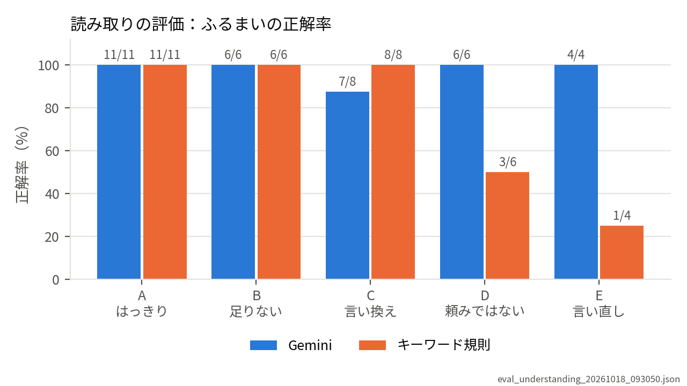
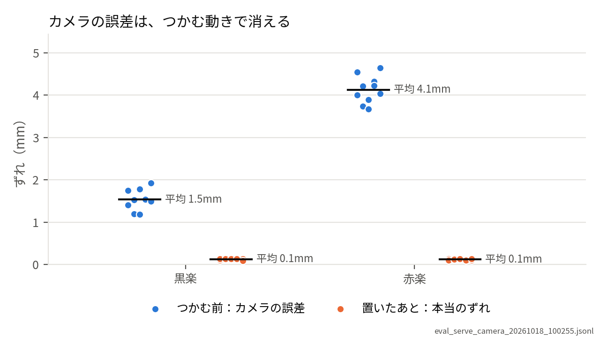

# kotoba_hakobu

**Listen. Confirm. Carry. Report.** — A language-driven pick-and-place robot on CRANE+ V2 (ROS 2 / Gazebo / MoveIt 2)

茶会で、亭主の言葉を聞いて、お客様にお茶碗をお出しするロボットです（シミュレーション）。
言葉で頼む → 確かめてから動く → 水平を保って運ぶ → 結果を報告する、を1つの流れにしています。

> 松尾・岩澤研究室「Physical AI 応用編1」の最終課題として作りました。動画：（提出のときに足します）

## 何をするロボットか

ロボットは、亭主に頼まれてお茶碗を運ぶ役です。茶碗は2つ（赤楽・黒楽）で、ロボットの右側に置いてあります。
お客様は3人で、ロボットから見て左から、お正客様・お次客様・お三客様（お詰め様）です。

```
亭主　　：黒楽をお正客様に
ロボット：黒楽のお茶碗を、お正客様にお出しいたします。よろしいですか？（はい／いいえ）
亭主　　：はい
　　　　　（1/14）茶碗の位置を読んでいます … （14/14）指を開いて離れ、置いた位置を確かめています
ロボット：黒楽のお茶碗を、お正客様にお出しいたしました（ずれ 0.1mm・傾き 0.1度・38秒）

亭主　　：お次客様にお出しして
ロボット：どちらのお茶碗にいたしましょう？（赤楽・黒楽）

亭主　　：赤楽をお正客様へ
ロボット：申し訳ございません。お正客様のお席には、もうお茶碗がございます。
```

## 特徴

- **確かめてから動く**：足りないことは聞き返し、動く前に必ず復唱して「はい」をもらう。「はい」以外の返事では動かない
- **動く前に断る**：茶碗が見当たらない・倒れている・手が届かない・席が埋まっている、を腕を動かす前に確かめて断る
- **水平を保って運ぶ**：茶碗を横からつかみ、運ぶ間の傾きを測る（要件は15度以内。評価では最大0.07度）
- **失敗したら安全に止まる**：茶碗を持っている間に失敗したら、指を開かずにその場で止まり、亭主に伝える
- **2通りの位置の読み方**：シミュレータの本当の位置（真の値版）と、天井のカメラで色から見つける方法（カメラ版）を、起動するときに切りかえられる。茶碗には印を付けない

## 仕組み

```
[亭主の操作盤 teishu_console]
   │ 指示の文
   ▼
[読み取り understanding]  Gemini（gemini-3.5-flash-lite・決まった形のJSONで答えさせる）
   │                      ＋ 予備のキーワード規則（Gemini が答えないとき）
   │ {茶碗, 席, 頼みの種類}
   ▼
 聞き返し・復唱・「はい」の確認
   │ ServeTea アクション（茶碗・席）
   ▼
[お出しするサーバー serve_server]  14段階：位置を読む→届くか→席はあいているか→つかむ→
   │                                持ち上げる→向きを変える→前へ出す→置く→離れて確かめる
   ├─ 位置を教える部品：TruePoseLocator（真の値版）／ CameraLocator（カメラ版：色→机の上の位置）
   └─ MoveIt 2（pymoveit2）で CRANE+ V2 を動かす
   │ 途中経過（feedback）・結果（ずれ・傾き・時間・失敗した段階）
   ▼
[亭主の操作盤]  報告する・やりとりを results/chakai_log_*.jsonl に1行ずつ書き足す
```

## 動かし方

### 環境

- Windows 11 ＋ WSL2（Ubuntu 24.04）＋ Docker Desktop ＋ VS Code（Dev Containers）
- 開発コンテナ：`.devcontainer/Dockerfile`（ROS 2 Humble、Gazebo、MoveIt 2、CRANE+ V2、pymoveit2）

### 準備

1. このリポジトリを VS Code の開発コンテナ（`.devcontainer`）で開きます。
2. Gemini の API キーを、コンテナの `~/.secrets/gemini_key` に `export GEMINI_API_KEY=（キー）` の1行で書き、`chmod 600` で本人だけが読めるようにします。`~/.secrets` はボリューム（`kotoba-secrets`）なので、コンテナを作り直しても消えません。端末を開くと自動で読み込まれます。キーはリポジトリに書かないでください。
3. ビルドします。
```
   cd /workspace
   colcon build --symlink-install
   source install/setup.bash
```

### 起動（端末を3つ。カメラ版は4つ）

| 端末 | コマンド |
|---|---|
| 1 シミュレータ | `ros2 launch crane_plus_gazebo crane_plus_with_table.launch.py world_name:=/workspace/src/kotoba_hakobu/worlds/chakai.sdf` |
| 4 カメラの橋渡し（カメラ版のみ） | `ros2 run ros_gz_bridge parameter_bridge "/chakai_camera/image@sensor_msgs/msg/Image[ignition.msgs.Image" "/chakai_camera/camera_info@sensor_msgs/msg/CameraInfo[ignition.msgs.CameraInfo"` |
| 2 お出しするサーバー | 真の値版：`ros2 run kotoba_hakobu serve_server`<br>カメラ版：`ros2 run kotoba_hakobu serve_server --ros-args -p locator:=camera` |
| 3 亭主の操作盤 | `ros2 run kotoba_hakobu teishu_console` |

- 新しい端末では、先に `source /workspace/install/setup.bash` を実行します。
- シミュレータの起動に `use_camera:=true` は付けません（天井のカメラは、茶会の世界のファイルに入っています）。
- 茶碗を最初の位置に戻すときは、シミュレータを起動し直します。

## 評価の結果

### 読み取りの評価（言葉）

評価用の35文（利用者が作り、評価が終わるまで Claude には見せていない）を、Gemini とキーワード規則で読み取り、ロボットのふるまい（断る・聞き返す・復唱）が正しいかを採点しました。

| | ふるまいの正解 | 危ない間違い（間違ったまま復唱に進む） |
|---|---|---|
| Gemini | **34/35** | 0 |
| キーワード規則 | 29/35 | 0 |



- はっきりした指示（A）の正解率は 100%（要件 90% 以上）
- キーワード規則は、頼みではない文（D）と言い直し（E）で大きく下がった
- 1回目の評価のあとに、問題集の3か所（文2つ・正解1つ）を直した。直していない32問では、Gemini は2回とも 31/32 で、答えは2回とも同じだった。詳しくは [eval/NOTES.md](eval/NOTES.md)

### お出しする評価（運ぶ）

茶碗の置き場所と席を、seed で決まるくじで変えながら、20回お出ししました。真の値版とカメラ版を、同じ seed で比べています。

| 位置の読み方 | 成功 | 本当のずれ（平均/最大） | カメラの誤差（平均/最大） | 傾き（最大） | 時間（平均） |
|---|---|---|---|---|---|
| 真の値版 | 20/20 | 0.1 / 0.2 mm | 2.8 / 4.6 mm | 0.07度 | 38.2秒 |
| カメラ版 | 20/20 | 0.1 / 0.1 mm | 2.8 / 4.6 mm | 0.07度 | 38.5秒 |



- カメラで見た位置は数mm ずれていても、指で茶碗をはさむと手の中の決まった場所に収まるので、置いた位置のずれは 0.1mm になった
- 直線の計画は、茶碗を持って向きを変えた直後の1回目に失敗しやすい（20回中15回）。0.5秒待ってやり直すと、すべて成功した
- 表は [results/figures/serve_summary.md](results/figures/serve_summary.md)、詳しくは [eval/NOTES.md](eval/NOTES.md)

### 限界

- シミュレータの中の結果です。本物のカメラの光のゆらぎ・影・雑音は含まれていません
- カメラの誤差がどこまで大きくなると、つかむ動きで吸収できなくなるかは測っていません
- 茶碗の正面（柄の向き）は扱っていません

### 評価を動かす

```
ros2 run kotoba_hakobu eval_understanding     # 読み取りの評価（eval/instructions_eval.csv を使う）
ros2 run kotoba_hakobu eval_serve             # お出しする評価（サーバーとシミュレータが必要。--seed・--trials で変えられる）
python3 tools/make_figures.py                 # 図と表を作る（results/figures/）
```

## テスト

計算と判断の部分（手首の位置、カメラの計算、Gemini の答えの形の確かめ、キーワード規則、採点、くじ、返事の判断）を、ロボットや Gemini を使わずに確かめます（53個）。
```
python3 -m pytest src/kotoba_hakobu/test/test_logic.py -q
```

## 主なファイル

| ファイル | 役目 |
|---|---|
| `src/kotoba_hakobu_interfaces/action/ServeTea.action` | 注文（茶碗・席）・途中経過・結果の形 |
| `src/kotoba_hakobu/kotoba_hakobu/teishu_console.py` | 亭主の操作盤（聞き返し・復唱・報告・記録） |
| `src/kotoba_hakobu/kotoba_hakobu/understanding.py` | 指示の読み取り（Gemini ＋ キーワード規則） |
| `src/kotoba_hakobu/kotoba_hakobu/serve_server.py` | お出しするサーバー（14段階・安全に止まる） |
| `src/kotoba_hakobu/kotoba_hakobu/bowl_locator.py` | 茶碗の位置を教える部品（真の値版） |
| `src/kotoba_hakobu/kotoba_hakobu/camera_locator.py` | 茶碗の位置を教える部品（カメラ版）と、真の値との比べる道具 |
| `src/kotoba_hakobu/worlds/chakai.sdf` | 茶会の世界（茶碗2つ・席3つ・天井のカメラ） |
| `src/kotoba_hakobu/kotoba_hakobu/eval_understanding.py`・`eval_serve.py` | 評価 |
| `src/kotoba_hakobu/kotoba_hakobu/try_*.py` | 作る途中で1つずつ確かめた試運転 |
| `tools/` | 色や指の形を測る道具・図を作る道具 |
| `eval/` | 評価用の問題集と覚え書き |
| `results/` | 評価・やりとりの記録と図 |

## 動作を確かめた版

| 部品 | 版 |
|---|---|
| 土台のイメージ | `osrf/ros:humble-desktop@sha256:fb07245b32187d74350be25323d8ad2f8ca5c25c325759911a1eff2267a49c1e` |
| CRANE+ V2（rt-net/crane_plus, humble） | `87486bb21abbdcba05aba4e06e377dae95d4b5ff`（2024-12-03） |
| pymoveit2（AndrejOrsula/pymoveit2） | `33314af864f86403e33f33d0c47e0c303e81630b`（2026-10-10） |
| Gemini（読み取り） | `gemini-3.5-flash-lite`（2026-10-15 に確認。無料枠：1分15回・1日500回） |
| Python・OpenCV・NumPy・matplotlib・pytest | 3.10.12・4.5.4・1.21.5・3.5.1・6.2.5 |

土台のイメージ・CRANE+・pymoveit2 の版は、`.devcontainer/Dockerfile` に書き込んである（2026-10-18）。rosdep・apt で入れる部品（MoveIt 2・日本語フォントなど）は、配布元が最新版のみを置いているため固定していない。作り直した環境で、テスト（53個）が通ることと、お出しする評価の2試行が作り直す前と同じ数字になることを確かめた。

## 出典・参考にしたもの

- [rt-net/crane_plus](https://github.com/rt-net/crane_plus)（CRANE+ V2 の ROS 2 パッケージ。ライセンスはリポジトリの LICENSE を参照）
- [AndrejOrsula/pymoveit2](https://github.com/AndrejOrsula/pymoveit2)（Python から MoveIt 2 を使う部品。同上）
- ROS 2 Humble のドキュメント：「Understanding actions」「Writing an action server and client (Python)」
- Gemini API のドキュメント：「Structured output」
- 松尾・岩澤研究室「Physical AI 応用編1」講義資料（講義資料は公開していません）
- 書籍『ROS2とPythonで作って学ぶAIロボット入門 改訂第2版』（講談社）

## AI の利用

- **Claude（Anthropic。主にブラウザのチャット）**：設計の相談、コードの大部分、テスト、評価のプログラム、この README の下書きに使いました。Claude が示した変更の一部は、利用者が自分で書き込みました。
- **利用者が決めたこと**：茶会でお茶をお出しする設定、茶碗（赤楽・黒楽）と席の呼び方・並び、傾きの要件（15度以内）、茶碗に印を付けないこと、茶碗をロボットの右側に置くこと、亭主への言葉づかい、評価用の問題集（評価が終わるまで Claude には見せない）。動作は、すべてシミュレータで動かして確かめました。
- **AI の間違いを見つけて直した例**：ROS の部品が使う名前（`handle`）と重なって起動しなかった／倒れた茶碗を見分ける基準（「詰まり 0.80」）が実際の値に合わなかった／図の点を値の順に並べ、誤解を生む図になっていた、など。
- **Gemini（Google）**：ロボットの中で、亭主の言葉を読み取るのに使っています。答えは必ず形を確かめてから使い、使えないときはキーワード規則に切りかえます。

## ライセンス

MIT License（[LICENSE](LICENSE)）