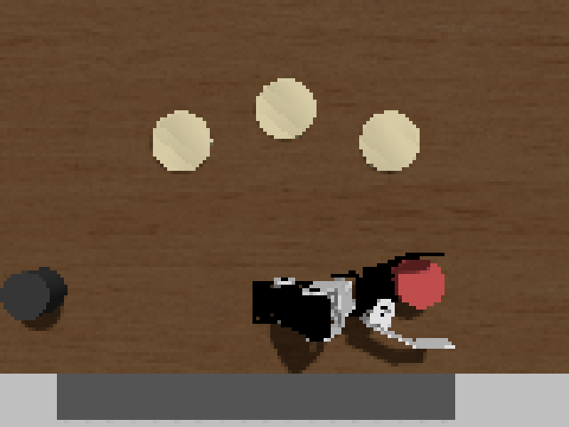
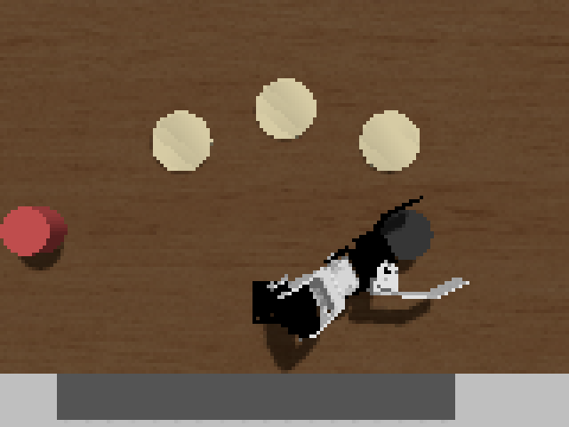
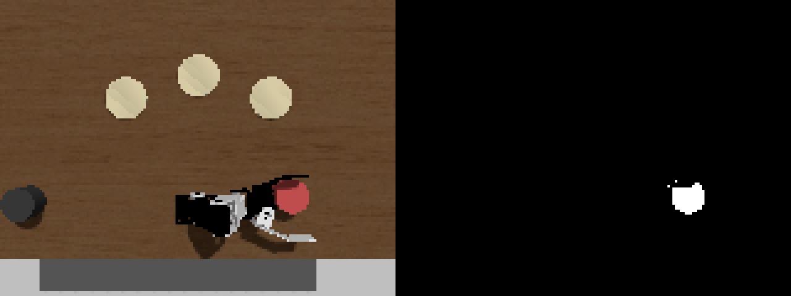
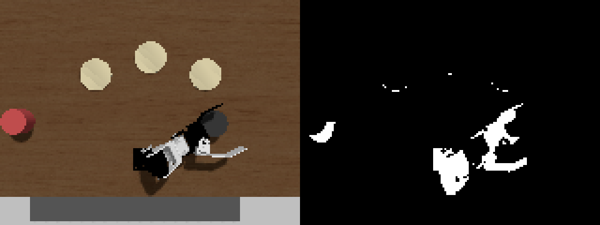

# 模倣学習（ACT）の記録

## 1. ねらいと結論

この作品は、茶会でお客様に抹茶碗を提供するロボットである（CRANE+ V2・Gazebo 上の
シミュレーション）。茶碗は楽焼の**赤楽**と**黒楽**の2種を机に用意し、**亭主**（茶会を
催してお客様をもてなす主人。このロボットの使い手）の言葉の指示を受けて、
頼まれた茶碗を頼まれたお席へ、水平を保って提供する。茶碗は円柱の模型
（直径6cm・高さ4cm）で見立てており、本物の抹茶碗（直径12cm前後）より小さく
デフォルメしてある。小型アーム CRANE+ V2 の指で挟める大きさに合わせたためである。

このアームで抹茶の提供を試みようと考えたきっかけは、**CRANE+ V2 の動きが茶道の
所作と似ている**と感じたことにある。茶碗を横から挟む動きは抹茶碗の
扱いに通じ（アームの指は両手に見立てた）、腕を前方へまっすぐ差し出す動きは、
お客様へ抹茶を差し出す所作にも見えた。機械の動きの中に茶道の所作との類似を
見つけたことが、この題材の出発点である。

本章はそのうち「茶碗をつかむ」工程（把持。提供の15段階のうち5〜7段階目）を
模倣学習で置き換えられるかを調べた記録である。

Physical AI 応用編1 の講義第5回「ROS 2入門（2/2）」の模倣学習演習と同じ方法
（pai_training・LeRobot・ACT）で把持を学習させ、本番の把持役（MoveIt）と同じ
評価指標で比べた。4日間で座標入力→画像入力→デモの設計改良→修正デモ→再試行の
仕組み、と改良を重ね、最終的に**赤楽の把持は学習方式（ACT）が本番を担当**する
ところまで到達した（本番と同じ仕組み（再試行・フォールバックつき）での採用試験で
20/20）。**黒楽は画像上で黒いアームと溶け合い精度が出ない**ことを立証し、
実証済みの MoveIt が担当する。適用範囲を測って決めた適材適所が、この章の結論である。

## 2. 作り方

- 環境：Physical AI 応用編1 講義第5回と同じ pixi（pai_training）・LeRobot
  （768e366 に固定）・ACT
- デモ（お手本となる実演）：キーボード操作の代わりに、本番の MoveIt の動き
  （提供の5〜7段階：茶碗の上へ→まっすぐ下ろす→閉じる）を自動で記録。
  茶碗は乱数シードで決めた位置に置き直す
- 記録：関節の角度（/joint_states）・天井カメラの画像。画像は 640×480 を
  縦横 1/4 の 160×120 に縮めてから記録した。**これは本来は避けたい妥協である**
  （画像の細かさ＝位置を読み取る精度のもとを、自ら捨てている）。ただし本課題の
  実行環境では、元の大きさのまま記録すると記録装置が溢れて肝心の関節の角度が
  欠けてしまい（実測：画像だけで10秒に78MB、関節の記録が本来の毎秒100回から
  毎秒1回まで低下）、CPU での推論も1秒20回の判断に間に合わなくなる。模倣学習の
  学習データは「画像と動きの組」なので、画像の細かさより組がそろうことを優先して
  縮めた。この粗さ（1ピクセル≒約4.5mm）が本章の精度の上限を決めており、十分な
  記録装置と推論用の GPU があれば縮めずに済む（8節の展望で再論する）
- 変換：rosbag → LeRobot 形式。静止しているフレームは除去（止まる癖の防止。
  ただし指を閉じ始めた後は残す）。腕の行動は「角度」ではなく「1フレームの差」
- 学習：Colab の GPU（A100）で 2万ステップ・約60分。datasets==3.6.0 に固定が必要
- 推論：CPU で約 50〜200ms/回。目標は「今の角度＋差×10フレーム」、全関節を同じ
  割合で縮めて上限 0.1rad（デモの統計から安全範囲を作る）

## 3. 最終結果（未学習の配置 seed 1018・同じ20か所）

| 方式（デモ・工夫） | こぼさず提供 | 衝突（ぶつけて1.5cm超動かした） | 備考 |
|---|---|---|---|
| MoveIt（座標の真値） | 20/20 | 0 | ずれは毎回ぴったり 0.9cm（閉じるときの送り込み。4節で説明） |
| 座標 ACT（60エピソード） | 11/20 | 0 | 失敗9は小さな接触・把持失敗。右寄り全滅 |
| 画像 ACT ねらい0.007（60エピソード） | 11/20 | **5** | 右寄りは克服。衝突が5回残る |
| 画像 ACT ねらい0.000（60エピソード） | 19/20 | 0 | 乗り上げ1（目視でのみ検出） |
| ＋修正デモ（89エピソード） | 18/20＋浅づかみ1 | 0 | 接触起因の失敗0。「直してから下りる」行動を獲得 |
| ＋再試行・把持の自己判定・フォールバック（本番採用の試験） | **20/20 完了** | 0 | 危険な把持が検知されず通った回0。フォールバックの出動1 |

- 浅づかみ＝茶碗の胴ではなく、薄いふちを上から浅くつまんだ持ち方。持ち上がりはするが、
  抹茶が入っていればこぼれる危険が高いため、成功とは分けて数えた
- 学習済みの配置（seed 2026）：ねらい0.000 で 10/10、修正デモ入りで 9/10
  （安全停止1・接触0）
- 黒楽（90エピソード・同じ条件）：試験は接触と安全停止の多発で不成立 → 原因を
  立証し（6節）、本番は MoveIt が担当

## 4. 評価指標の設計史（茶道の視点で3回作り直した）

抹茶が入っている前提では「茶碗に当てて動かす」が最悪の失敗になる。その判定を、
測定と観察で3段階磨いた。

1. **第1版：横ずれ 1cm 超＝失格。** MoveIt にも毎回 0.9cm のずれがあり、正体不明のまま
2. **すべりの法則の発見**（ねらいを5つの値に振る実験）：ずれ＝「手首方向への
   引き込み 0.9cm（一定）」＋「固定の左指の定位置までの横すべり（最初のすき間と
   一致）」の合成（三平方の定理と一致）。つまりこれは、指を閉じるときに茶碗を
   ゆっくり定位置まで**送り込む**動き（以下「送り込み」と呼ぶ）であり、
   ぶつけて弾き飛ばす「衝突」ではない
3. **第2版：1.5cm 超＝衝突。** 送り込みで起きうるずれの物理的上限
   （√(0.9²+1.2²)≒1.4cm）と、亭主（茶道の経験を持つ利用者）の判断（抹茶は茶碗の
   四分の一以下しか入らない。遅い 1.4cm のすべりではこぼれない）が同じ線を指した
4. **第3版：持ち上がった＝正しく送り込めた証拠。** 上からふちを打った場合は
   持ち上げ自体が失敗することを確認し、「持ち上げ成功＝こぼしていない」を採用。
   ただし横ずれの指標は「上からの乗り上げ」を検出できないことが**目視で**判明した
   ため、目視の接触記録を併用。最後に**把持の自己判定**（手の角度 15 度未満＝
   浅づかみ。正しい持ち方は 18〜20 度、把持失敗は 35 度）を加え、検知されない
   危険を 0 にした

教訓：判定結果ではなく生の値（ずれ cm・手の角度）を記録しておけば、評価指標を
作り直しても測定のやり直しは不要だった。

## 5. 診断と改良の記録（時系列）

いきなり成功したわけではない。各段階で「測って、原因を絞り、1つだけ直す」を
くり返した。

**座標入力の ACT（デモ60エピソード・茶碗の座標を入力）**
- 学習後、腕が途中で止まる。0.5秒ごとの記録を仕込んで診断し、3つの原因を順に直した：
  1. 学習データの12%が「静止しているフレーム」→ 除去（止まる癖の防止）
  2. 行動を「角度そのもの」（ばらつき約35度）から「1フレームの差」（0.16〜0.59度）へ
     → ものさしの粗さが合い、答えの向きが正しくなった
  3. 目標の置き方を3回作り直した（差をそのまま→速度1/12で進まない。目標を
     積み上げ→行き過ぎて止まらない。最終形：今の角度＋差×10フレーム、全関節を
     同じ割合で縮めて上限0.1rad）
- 結果：未学習の配置で 11/20。ただし右寄り（x≧0.05）は全滅。「右寄りのデモが
  少ないせい」という仮説は、デモの分布を数えて棄却（右寄りは60エピソード中26あった）

**画像入力へ（本家 ACT 論文は画像入力で成功している、という筋を追試）**
- 天井カメラの画像だけから茶碗の位置を読ませる（座標は渡さない）
- 右寄りの全滅が解消。座標では表せない何かではなく「座標の精度」が壁だったと判明

**デモの通り道の実測 → ねらいの変更（0.007 → 0.000）**
- MoveIt のねらい（茶碗を指のどこに迎えるか）を5つの値に振って送り込みを実測し、
  4節の法則を発見。新しい評価指標のもとでは通り道の中央＝真ん中ねらいが最適と
  分かり、デモを取り直して再学習 → **11/20 が 19/20 に跳ねた**
- 左右どちらの誤差も受け止められる配置になったことが効いたと考えられる

**修正デモ（DAgger の発想。Ross ら 2011, arXiv:1011.0686）**
- 残った失敗は「ずれたまま下りて接触」。デモ（MoveIt）は一度も間違えないため、
  学習データに「ずれた状態からの直し方」が1フレームも無いのが原因と考えた
- 安全な高さでわざとずらした位置へ行き、正しい位置へ立て直してから下りる修正デモを
  29エピソード追加（計89エピソードで再学習）。なお立て直しの横移動は「まっすぐ」
  では計画できない（4関節の腕は横の直線移動で姿勢のつじつまが合わない。0%失敗で
  発見）ため、ふつうの計画で行った
- 結果：目視で「明確にずれたときは、直してから下りる」行動を確認。接触が
  そのまま失敗になる回が 0 になった

**失敗を自分で検知して立て直す仕組み（本番採用の試験）**

本番で使うには、失敗したときに人の手を借りず立て直せる必要がある。そこで
3つの仕組みを重ねた。

1. **把持の自己判定**：指を閉じたあとの手の角度で、結果を機械的に見分ける。
   約35度＝何も挟めていない（把持失敗）、18〜20度＝茶碗の胴を正しく挟めた、
   15度未満＝ふちだけを浅くつまんだ（浅づかみ。危険なので成功と認めない）
2. **自動の再試行**：把持失敗・浅づかみと判定したら、手を開いて上空へ戻り、
   最初の姿勢からつかみ直す（最大3回）。入力が画像なので、1回目の失敗で茶碗が
   数mm動いてしまっても、2回目はその「今の位置」を見てやり直せる
3. **フォールバック**：3回で決まらない場合は、従来方式（MoveIt）が引き継ぐ。
   これにより、学習方式の調子に関わらず、提供そのものは必ず完了する

この仕組みごと、本番と同じ条件で20回試験した（本番採用の試験）。結果は
**20回すべてで提供を完了**。危険な把持（浅づかみ）が検知をすり抜けた回は 0。
フォールバックの出動は1回で、その1回（腕がぎりぎり届く右端の位置）では
「接触→自動の再試行→浅づかみを自己判定で却下→フォールバックが正しい持ち方で
完了」と、3つの仕組みが設計した順番どおりに連鎖して働いた。

**運用面の発見（測定の信頼性）**
- シミュレータは長く動かすと計画の失敗が増える。測定・デモ収集の前に起動し直す
- `ros2 topic hz` は大きな画像を実際より少なく数える。カメラの健康診断は軽い
  camera_info（毎秒8前後が正常）で行う
- 環境が疲れた状態の数字は、方式の実力ではなく環境を測ってしまう。試験の前提
  条件（カメラ毎秒7以上）を決め、満たさなければ測らない

## 6. 黒楽の検証（なぜ学習方式を使わないか）

赤楽で最も成績の良かった条件（ねらい0.000・修正デモ入り・計90エピソード）を
そのまま適用して黒楽モデルを学習したが、試験では接触と安全停止が多発し、
成立しなかった。原因を4つの柱で立証した。

1. **条件の統制**：腕・カメラ・解像度・学習条件・学習ステップ数・茶碗を置く場所
   （同じ乱数シード）まで赤楽と同一。違いは画像に写る茶碗の見た目だけ
2. **実物の証拠**：デモの画像（results/mihon_black_*.png）で、黒楽は接近した黒い
   アームと**ひとつの黒いかたまり**に溶ける。しかも溶けるのは、mm単位の精密さが
   一番要る接近の瞬間だけ。赤楽（mihon_red_*.png）は同じ場面で輪郭が立っている
3. **症状の一貫性**：ためらい・行きつ戻りつ・上から押す（目視）、安全停止の多発
   （押した接触で物理計算が渋滞し配信が途切れる下流の症状）、学習の損失も高止まり
   ——すべて「位置が画像から読めない」の枝分かれで説明がつく
4. **消去法**：同じ機械で MoveIt は黒楽を 20/20（機械は無罪）。カメラから
   サーバーへのデータの通り道も同じままで赤楽 ACT は正常（通信の仕組みは無罪）。
   PC再起動直後でも再現（環境の疲れも無罪）

デモの画像（接近の瞬間。モデルに入るのと同じ 160×120 画素を2倍に拡大）：

| 赤楽：輪郭が立っている | 黒楽：黒いアームと溶けている |
|---|---|
|  |  |

さらに機械的な検査も行った（results/shikibetsu_*.png）：「赤っぽい画素を選べ」

さらに機械的な検査も行った（results/shikibetsu_*.png）：「赤っぽい画素を選べ」
という単純な規則で赤楽は1個の白いかたまりとして取り出せるが、「暗い画素を選べ」
では黒楽・アーム・影が混然となり、黒楽だけを取り出す規則が作れない。つまり
**答え（黒楽の位置）が入力の画像に実質書かれていない**。書かれていない答えは、
デモを何エピソード増やしても読めない。

| 「赤っぽい画素を選べ」：赤楽だけが白く残る | 「暗い画素を選べ」：黒楽・アーム・影が混ざる |
|---|---|
|  |  |

（各図は、左が元の画像、右が規則で選んだ画素を白で示したもの）

茶碗の色を変えれば直る見込みはあるが、採らなかった。

茶碗の色を変えれば直る見込みはあるが、採らなかった。黒楽は黒いから黒楽であり
（茶道の視点）、実世界では機械の都合で茶碗を塗り替えられない（工学の視点）。
ただし実機で運用する場合には、**茶碗ではなくロボットの側の色を変える**手が採れる。
アームや指を白などの明るい色にすれば、黒楽との溶け合いは起きなくなる。機械の
都合は機械の側で吸収する、という同じ原則の実用解であり、塗装だけで済むぶん
手首カメラの追加より安価である。本課題のシミュレーションでは、アームの色を
変えると赤楽の学習済みモデル（学習データは黒いアームで撮影済み）まで学習し直しに
なるため見送り、展望として記す。よって黒楽の提供は、実証済みの MoveIt が担当する。

## 7. 本番の設計（適材適所の階層）

```
亭主の言葉 → Gemini（読み取り・聞き返し・復唱）
          → serve_server（検品と振り分け：どの茶碗か・どの席か）
          → 把持：赤楽 = ACT（再試行＋把持の自己判定＋フォールバックの MoveIt）
                  黒楽 = MoveIt（画像から位置が読めないため）
          → 運び・置き：MoveIt（水平を保つ15段階）
```

- 設計の原則：**取り返しのつかない失敗（こぼす）は部品の段階で潰し、取り返しの
  つく失敗（把持失敗）は再試行で救う**。1回あたりの成功率より、危険が検知されず
  通らないことを優先した
- ACT には「どの茶碗か」を受け取る入力が無い（画像と関節の角度だけ）。言葉の理解は
  上の階（Gemini・serve_server）で済んでいるので、茶碗ごとの専用モデルを
  serve_server が呼び分ける方式にした（言葉をモデルに入れる方式は VLA として展望に）
- 帰り道：起動設定 grasp:=moveit で、全段階を従来の MoveIt だけで動かす構成に
  いつでも戻せる
- 通しの試験が、部品の試験では原理的に見つからない統合の欠陥を2つ発見した：
  (1) 画像を縮める係が測定道具の中に間借りしていて、本番の編成にいなかった
  → ACT サーバーが元画像を自分で縮める自給自足に直した
  (2) 黒楽を頼んでも ACT が赤楽へ向かった（上記の入力の欠落）→ 振り分けで解決。
  最終の通しでは、赤楽（ACT・ずれ0.1mm）と黒楽（MoveIt・ずれ0.1mm）の連続提供に成功

## 8. 限界と展望

- **精度の床は何枚も重なっている**：画像の粗さ（1ピクセル≒4.5mm。2節の妥協）の
  下に、画像の頻度（実質毎秒2枚＝0.5秒前の世界を見ている）、接近時の死角（真上
  カメラは肝心の瞬間に手が茶碗に重なる）、触覚の不在が続く。解像度だけ上げても
  次の床で頭打ちになるため、改善は床の実測とセットで行うべき
- **安全装置の網の目**：感覚の途絶（2秒）では止まれるが、精度を壊す程度の遅れ
  （0.3〜0.9秒）は検知の線の手前ですり抜ける。鮮度に応じて動きを緩める中間の線が
  今後の課題
- **触れた瞬間の検知**：乗り上げ・かすりは横ずれの指標に写らず、本章では目視で
  補った。実用には関節の力（電流）による接触検知のガードが本命
- **言葉で茶碗を選べるモデル**：ACT は入力に言葉を持てない。言葉と画像を一つの
  モデルで扱う VLA（例：SmolVLA）が、この限界の正道の解になる
- 本章の結果はシミュレーションに限る：実機なし・液体（抹茶）なし・茶碗は円柱の
  模型。送り込みの物理（引き込み・横すべり）も本物の茶碗と畳では変わりうる

## 9. 再現の手引き

- 良いデモ（il_data/rosbags/、git 管理外）：座標 20261019_084826／画像ねらい0.007
  20261020_085937／ねらい0.000 20261021_015942／修正デモ29エピソード
  20261021_092849／黒楽 20261022_030954・20261022_034012
- モデル（il_data/checkpoints/）：crane_plus_grasp_act_img_dagger（赤楽・本番）／
  crane_plus_grasp_act_img_black（黒楽・不採用の検証用）
- デモ収集：`python3 -m kotoba_hakobu.collect_grasp_demos --episodes 60 --seed 2026
  --aim-left 0.000 [--jitter 0.02] [--bowl black]`（シミュレータを起動し直してから。
  カメラの橋渡しも起動）
- 変換：`python il/convert_grasp_img.py il/configs/conversion_img_＊_config.yaml`
  （pixi の箱の中）
- 学習：Colab の GPU。lerobot を 768e366 で入れ、datasets==3.6.0 に固定。
  約60分。持ち帰った config.json は "type": "act" の追記と device を cpu に直す
- サーバー：`python il/act_grasp_server_img.py [--service /kotoba/act_grasp_red
  --model-path … --dataset-root … --repo-id …]`（複数同時起動できる）
- 試験：`python3 il/try_act_grasp.py --method act --trials 20 --seed 1018
  --aim-left 0.000 --retries 2 --fallback [--bowl black]`。測る前にカメラの健康診断
  （`ros2 topic hz /chakai_camera/camera_info` が毎秒7以上）
- 結果の記録は results/ に全て残してある（jsonl は生の値つきで、評価指標を
  変えても採点し直せる）